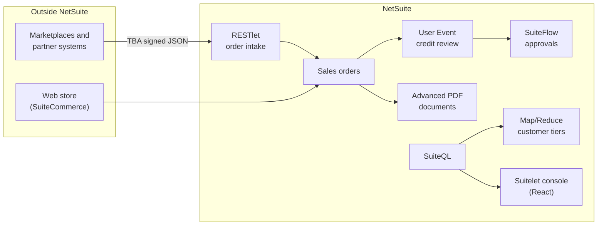

# NetSuite Samples · Dilshad Ali

**NetSuite Architect, techno-functional.** I design and build NetSuite solutions end to end: the business process, the configuration, the server side, the screens people use, the web store and the integrations with other systems.

This repository has short, focused samples from each of those layers. Every file is original and written for this portfolio. None of it is client code or client data.

[Upwork profile](https://www.upwork.com/freelancers/~01b9fd4cc496f6fae0)


## Where I work in NetSuite

| Layer | What I cover |
| --- | --- |
| **Business process** | Order to Cash, Procure to Pay, inventory and fulfillment, Record to Report, approvals and controls, multi-subsidiary and intercompany, consignment, eCommerce and marketplace selling |
| **Configuration and administration** | Features, preferences, roles and permissions, forms, custom records and fields, SuiteFlow workflows, saved searches, sandbox to production releases |
| **Back end** | SuiteScript 2.1 of every type: User Event, Client, Map/Reduce, Scheduled, RESTlet, Suitelet, Workflow Action. Governance-aware design for high volumes |
| **Front end** | Suitelet applications in React and Bootstrap, SuiteCommerce Advanced extensions and themes, Advanced PDF/HTML templates |
| **Integration** | RESTlets, SuiteTalk REST and SOAP, Token Based Authentication and OAuth 2.0, marketplace and storefront order flows, duplicate-safe imports |
| **Data and reporting** | SuiteQL, saved searches, SuiteAnalytics workbooks, KPI dashboards |
| **Engineering** | SDF projects in Git, unit tests on SuiteScript, CI on every push |

## How the pieces fit



## Samples

| Area | Sample | What it shows |
| --- | --- | --- |
| Integration | [Order intake RESTlet](src/FileCabinet/SuiteScripts/DA/OrderIntake/) | Validated channel orders created exactly once through External ID, race safe, always answering in JSON |
| Integration | [Order intake client](integration/order_intake_client.js) | The calling side in Node: OAuth 1.0 HMAC-SHA256 request signing with no libraries |
| Order to Cash | [Credit review](src/FileCabinet/SuiteScripts/DA/CreditReview/) | Holds risky orders in the standard approval queue, judged on full exposure including unbilled orders, with the reason on the order. Ships with its SDF objects |
| Sales control | [Margin guard](src/FileCabinet/SuiteScripts/DA/MarginGuard/DA_CS_Margin_Guard.js) | Client Script that catches below-margin lines and quotes the lowest acceptable rate |
| Customer data | [Customer tier](src/FileCabinet/SuiteScripts/DA/CustomerTier/DA_MR_Customer_Tier.js) | Map/Reduce over trailing twelve month sales, aggregated in SuiteQL, writing only real changes |
| Approvals | [Approval level](src/FileCabinet/SuiteScripts/DA/ApprovalRouting/DA_WA_Approval_Level.js) | Workflow Action that reads a finance-owned matrix so routing stays visible in SuiteFlow |
| Front end | [Operations console](src/FileCabinet/SuiteScripts/DA/OpsConsole/) | Suitelet single page app in React and Bootstrap: KPIs, search, filter and sort, no build step |
| Web store | [Minimum order notice](commerce/MinimumOrder/) | SuiteCommerce extension on the Extensibility API with live cart updates and admin configuration |
| Documents | [Packing slip](pdf/packing_slip.xml) | Advanced PDF template with barcode, repeating header, shaded rows, unit total and sign off |
| Reporting | [SuiteQL](suiteql/) | AR aging, net sales by item and month, duplicate customers, late purchase order lines |

## Quality

```
npm install
npm test        # unit tests on the SuiteScript and the integration client
npm run lint
```

Tests and lint run in [GitHub Actions](.github/workflows/ci.yml) on every push.

## Certifications

Oracle NetSuite: BI & Reporting Associate, AI Foundations Associate.
